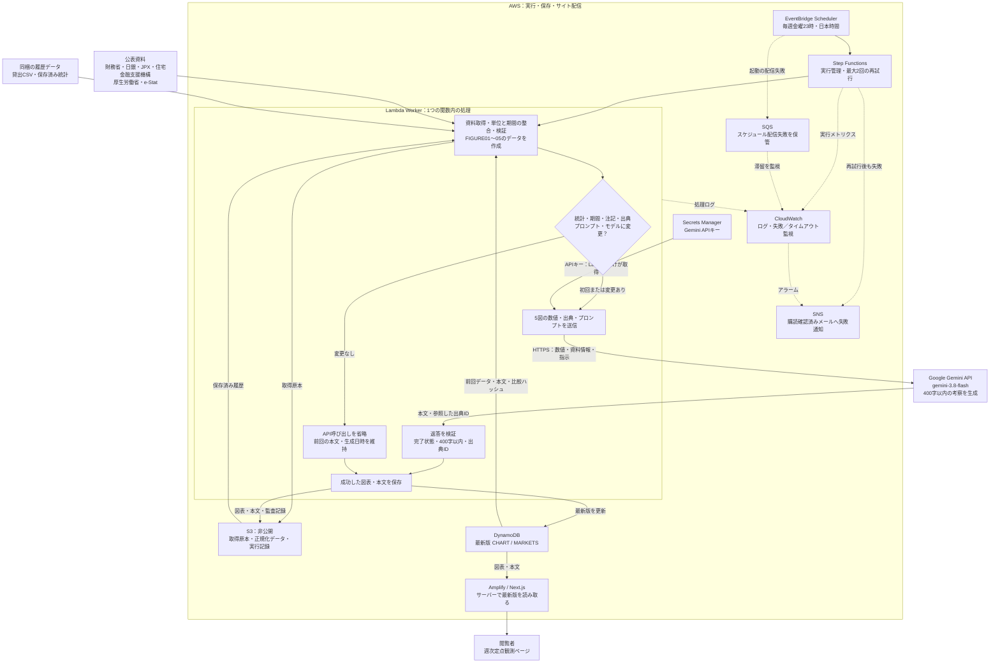

# 週次定点観測のデータフロー

対象は `reportbank-weekly` の `ReportScope=markets`。リポジトリの実装を基に作成。AWS上の接続・初回生成・スケジュール有効化の完了を示す図ではありません。自動起動はScheduleStateをENABLEDにした後です。

- 毎週確認するのは統計です。取得日時だけが変わっても本文は再生成しません。初回、モデルやプロンプトを変更した場合は再生成します。
- `markets` はStep FunctionsのCollect内で収集から生成・保存まで行い、`AlreadyPublished → Done` で終了します。図のLambda内の箱は別々の関数ではありません。
- 収集・生成・検証で失敗すると最新版を書き換えず、前回の掲載を維持します。失敗した回でも、途中まで取得した原本がS3に残る場合があります。
- Geminiキー未設定の場合は図表のみ更新します。図のAI生成を動かすには `GeminiSecretArn` の設定が必要です。
- FIGURE02の貸出は同梱データを使い、新しい貸出統計の自動取得は未実装です。他の系列も公表頻度・履歴取得の制約があり、週ごとに数値が変わるとは限りません。
- S3には実行ごとの記録を保存しますが、`markets` の本文をサイトの「過去の400字整理」一覧へ追加する処理は未実装です。
- Amplifyには対象テーブル名・リージョン・読み取り用Compute roleを設定します。未接続時にも同梱の図表が表示されるため、掲載本文とDynamoDBを照合して接続を確認します。Geminiキーはブラウザには渡しません。
- Googleの無料枠はGoogle側で確認します。AWS料金は別です。Bedrockは使用しません。

参照：[構築手順書](weekly-reports-aws-setup.md)、[AWSテンプレート](../infra/weekly-reports.yaml)、[Lambda処理](../workers/weekly-report/index.py)、[更新判定](../workers/weekly-report/insight_config.py)、[生成プロンプト](../workers/weekly-report/weekly-insight-prompt.txt)。
