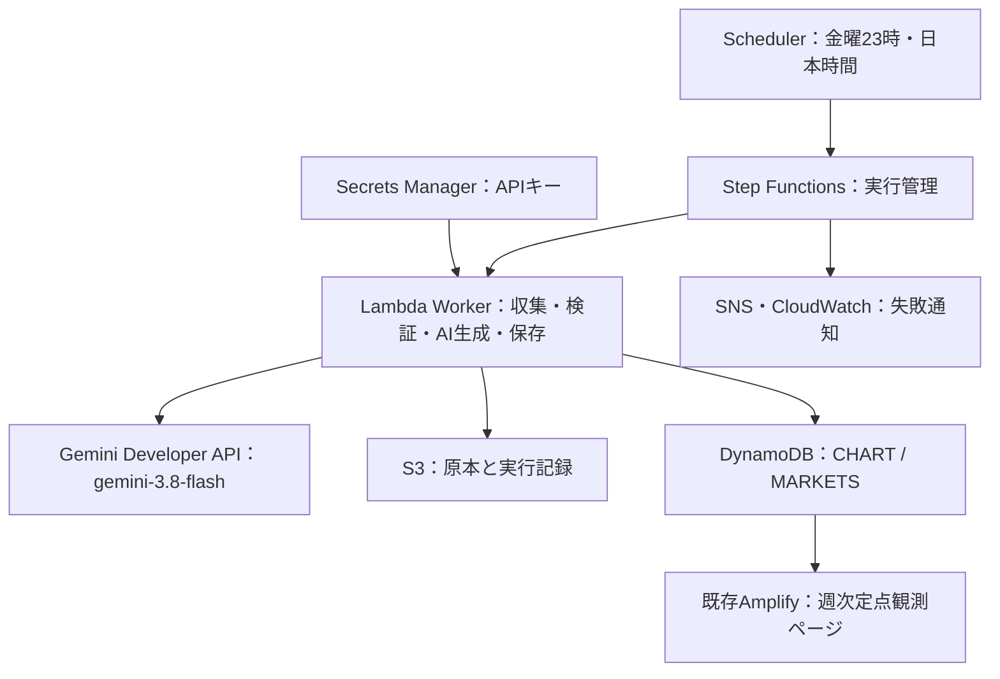

# ReportBank 週次定点観測：AWS構築手順書（Gemini API無料枠）

対象：WindowsのPCから、現在のFIGURE01～05とWeekly Insightを毎週更新する方。確認日：2026年10月18日。Weekly Insightの考察対象はFIGURE01～05です。

**この手順書は構築の説明書です。AWSへの作成・公開・課金を伴う操作は、まだ実行していません。**


**実装状況：Lambda・SAMテンプレートをGemini APIに対応させました。FIGURE01～05の値・期間・注記・出典またはプロンプト／モデルに変更がある場合だけ本文を生成します。変更がなければ前回本文と生成日時を維持します。AWSへのデプロイと実キーでの接続確認は未実施です。**

今回は **Lambda → Gemini Developer API** の直接接続です。Amazon Bedrock・Vertex AIの設定、OpenAIのAPIキー・入金は不要です。Googleの無料枠はAI呼び出しに適用され、Lambda・Secrets Manager・S3などのAWS料金は別です。

## 最初に：何をすれば完成するか

AWSの各サービスを一つずつ手作業で作る必要はありません。リポジトリにある `infra/weekly-reports.yaml` が設計図です。PCでAWS SAMというツールを実行すると、CloudFormationが必要なサービスと接続権限をまとめて作ります。コンソールではAPIキーの保存、Webサイトとの接続、動作確認を行います。

既にReportBankがAmplifyで公開されている前提です。新しいAmplifyアプリ、ドメイン、広告・決済用スタックを作り直す手順ではありません。

| 順番 | 作業 | 操作する場所 | 完了の目印 |
| --- | --- | --- | --- |
| 1 | 使用アカウントとPCの準備 | AWSコンソール・PowerShell | AWSアカウント番号を確認できる |
| 2 | Gemini APIキーを保存 | Google AI Studio・Secrets Manager | シークレットARNを控えた |
| 3 | AWS一式を作成 | PowerShell・CloudFormation | スタックがCREATE_COMPLETE |
| 4 | 通知を有効化 | メール・SNS | 購読が確認済み |
| 5 | 初回レポートを生成 | Step Functions | markets-publishedと本文を確認 |
| 6 | サイトから読めるよう設定 | IAM・Amplify | 本文作成日時が初回実行の日時になる |
| 7 | 毎週の実行を有効化 | PowerShell・Scheduler | 東京時間の金曜23時、ENABLED |

### この手順書で使うアカウントと権限

**最初に、下表の「AWS構築担当」に該当する自分のログイン先・ロール名を確認してください。** 「構築担当」「運用担当」は本書での呼び名です。その名前のユーザーやロールがAWSに既に存在するという意味ではありません。実際のアカウントID・ロール名は手順1のメモに記入します。同じ人が複数の担当を兼ねても構いません。

| 本書での呼び名 | どこへ、何の資格でログインするか | 行うこと・必要な権限 |
| --- | --- | --- |
| PC作業者 | 自分のWindowsユーザーでPCへログイン | プロジェクトの読み書きとコマンド実行。ツールのインストーラーが要求する場合だけWindows管理者権限を使用 |
| AWS構築担当 | ReportBankを置いている12桁のAWSアカウントへ、組織が割り当てたSSO許可セット／IAMロールでログイン | 下記の構築・IAM設定・Secrets Manager・Amplifyの変更が許可されたロールを使用 |
| AWS運用担当 | 同じAWSアカウントへ、運用用の許可セット／IAMロールでログイン | 実行・停止、ログ・生成データの確認。閲覧専用ロールでは手動実行や停止はできない |
| Google設定担当 | [Google AI Studio](https://aistudio.google.com/)へ自分のGoogleアカウントでログインし、ReportBank用Google Cloudプロジェクトを選択 | プロジェクト参照・APIキー作成・必要なAPI有効化。作成できない場合は手順2-1の権限をGoogle Cloud管理者に確認 |
| メール受信者 | `AlertEmail` に指定する受信箱へログイン | SNS購読確認メールを開いて承認。メール内の承認操作にAWS管理権限は不要 |
| サイト確認者 | 通常のブラウザで公開URLを開く | 閲覧のみ。AWS・Googleへのログインは不要 |

**Windowsの「管理者として実行」、AWSの権限、Google Cloudの権限は、それぞれ別です。** PowerShellを管理者として開いてもAWSの権限は増えません。AWSコンソールにログインしただけでは、PCのAWS CLIも同じアカウントになるとは限りません。手順1-4でCLIの接続先とロールを確認します。

### AWS構築担当に用意する権限（管理者への依頼用）

権限を管理する方へ、この表と [infra/weekly-reports.yaml](../infra/weekly-reports.yaml) を渡してください。下表は必要な作業範囲と代表的なアクションであり、そのまま貼り付けるIAMポリシーではありません。実際のリソースARN、組織のSCP・アクセス許可境界、コンソール用の一覧取得権限に合わせて管理者が設定します。

| 作業 | 権限の範囲・代表例 |
| --- | --- |
| SAMで作成・更新（手順3・7） | 対象CloudFormationスタックの変更セット作成・実行・参照、デプロイ用S3へのアップロード。初回SAM管理バケットの作成も含む |
| テンプレート内リソースの構築 | Lambda、S3、DynamoDB、Step Functions、SNS、SQS、EventBridge Scheduler、CloudWatch Logs・Alarmの作成・更新・参照・タグ付け、および失敗時のロールバックに必要な削除等 |
| 実行ロールの構築・割り当て | 対象IAMロール／ポリシーの作成・更新・参照・関連付け。`iam:PassRole` はこの構成のロールと渡すサービスに限定。例：`iam:CreateRole`、`iam:PutRolePolicy`、`iam:AttachRolePolicy`、`iam:GetRole` |
| APIキー保存（手順2） | 対象シークレットの `secretsmanager:CreateSecret`、`DescribeSecret`。既存キーの差し替えは `PutSecretValue`。一覧・タグなど画面操作に必要な権限も付与 |
| 初回実行・検証（手順5） | 対象Workflowの `states:StartExecution`、`DescribeExecution`、`GetExecutionHistory`。対象DynamoDBの `GetItem`／`Query`（画面でスキャンする場合は `Scan`）、S3の `ListBucket`／`GetObject`、ログの閲覧 |
| サイト接続（手順6） | 対象Amplifyアプリ・本番ブランチの参照／更新／デプロイ。例：`amplify:GetApp`、`UpdateApp`、`UpdateBranch`、`StartJob`。SSR用IAMポリシーの作成・付与、対象Compute roleの `iam:PassRole` |

本書の `sam deploy` コマンドはCloudFormation専用のサービスロールを明示指定しません。新規スタックではCLIでログインした構築担当の権限を基にリソースを作成するため、**CloudFormationへのアクセス権だけでは足りません**。既存スタックにサービスロールが設定済みの場合は、そのロールの権限も管理者が確認してください。[CloudFormationの実行権限](https://docs.aws.amazon.com/AWSCloudFormation/latest/UserGuide/using-iam-servicerole.html)

`iam:PassRole` は「AWSサービスに指定した実行ロールを使わせるための権限」です。作業者がそのロールにログインする操作ではありません。[IAM公式説明](https://docs.aws.amazon.com/IAM/latest/UserGuide/id_roles_use_passrole.html)

### 作業者のログインと、自動処理の実行ロールを分ける

| 自動処理 | 使用する権限 | 用意する場所 |
| --- | --- | --- |
| Scheduler → Step Functions | 対象Workflowの開始、失敗時のSQS送信 | 手順3でテンプレートが `SchedulerRole` を作成 |
| Step Functions → Lambda・SNS | Workerの呼び出し、失敗通知の発行等 | 手順3でSAMがWorkflow用ロールを作成 |
| Lambda Worker → S3・DynamoDB・Secrets Manager | 原本と生成結果の保存、指定シークレット取得、ログ出力 | 手順3でSAMがWorker用ロールを作成 |
| AmplifyのSSR → DynamoDB | 対象テーブルの `GetItem`・`Query` | 手順6でCompute roleに付与 |

これらはAWSサービスが使用するロールです。作業者はAWS構築担当／運用担当として操作します。サービスの実行ロールにログインし直す必要はありません。

### 今回の設定は `markets`（ここではまだ入力しません）

`ReportScope` はReportBank用テンプレートの設定項目です。**手順3-2で、PCのPowerShellに表示される `Parameter ReportScope [markets]:` という質問へ `markets` と入力します。** `[markets]` が既定値ならEnterだけでも同じです。AWSコンソールでこの名前のサービスを探す操作はありません。

名前は古いですが、現在はFIGURE01～05の収集・保存に対応しています。本文の考察対象もFIGURE01～05です。`full` は別の13系列を扱うモードなので選びません。

Gemini対応版の構成は次のとおりです。プロンプトと更新判定は手順3-0を参照してください。



Lambdaは1つです。`markets` ではStep Functionsの **Collect内で生成・保存まで完了**します。画面上のGenerate・Publishを通過しなくても正常です。

### 構築しても変わらない、現在の制約

| 項目 | 週次実行の動作 |
| --- | --- |
| 国債金利・フラット35 | 公表資料を再取得。半期末グラフなので毎週棒・線が増えるわけではない |
| TOPIX | JPXの年間四本値Excelを再取得。年末値の資料なので、毎週の株価を表示するものではない |
| FIGURE02の貸出 | 同梱CSV・法人向けAPI応答の保存データを使用。新しい貸出データへの自動更新は未実装 |
| 日銀資産 | 指定の財務諸表を再取得。古い期間を他統計で埋めない |
| 政府債務・利払費 | 最新残高・予算総額を再取得。新年度の利払費を追加。保存済み年度の利払費は維持 |
| FIGURE05の所得・失業率 | 最新の年次統計を再取得。所得は調査前年に配置し、未調査年を補間しない |
| Weekly Insight | キー設定時に5図のデータに変更がある場合のみ400字以内で生成。モデルの自動切替なし |
| 「過去の400字整理」欄 | `markets` の本文をこの一覧へ追加する処理は未実装。実行ごとの本文はS3に保存される |

**AWSを構築するだけで、貸出の自動取得や過去本文の一覧保存が追加されるわけではありません。** この手順の完成条件は「5図の掲載・現行収集処理とGeminiによる最新本文の週次実行」です。

## 1. アカウント・PCを準備する

### 1-1. 作業メモを用意する

**操作場所：** PCのメモ帳など。

**使用アカウント：** PC作業者。

**必要な権限：** メモの保存先への書き込み。AWS操作なし。

次の表を自分用メモにコピーしてください。APIキーそのものはこのメモに書きません。

| 項目 | 記入する値 |
| --- | --- |
| AWSアカウントID | 12桁の番号 |
| AWSログイン先・ロール名 | アクセスポータルURLと構築用許可セット／ロール名 |
| CLIの実行者ARN | 手順1-4の `Arn` を記入 |
| Googleアカウント・プロジェクト | 使用するGoogleアカウント・プロジェクト名・プロジェクトID |
| AWSリージョン | `ap-northeast-1`（東京） |
| AWS CLIプロファイル | この手順では `reportbank` |
| スタック名 | この手順では `reportbank-weekly` |
| 通知メールアドレス | 自分が受信・確認できるアドレス |
| GeminiSecretArn | 手順2で記入 |
| ReportsTableName / ReportsTableArn | 手順3で記入 |
| DataBucket / WorkflowArn / ScheduleName | 手順3で記入 |
| Amplifyアプリ名・本番ブランチ名 | 現在公開中のもの |

ARNはAWSリソースの住所のような識別子です。APIキーとは別の値です。

### 1-2. AWSにログインする

**操作場所：** ブラウザ → AWSアクセスポータル／AWSコンソール。

**使用アカウント：** AWS構築担当。

**必要な権限：** 冒頭の構築権限表を参照。閲覧専用ロールでは構築不可。

1. AWSコンソールへ、普段ReportBankを管理しているアカウントでログインします。
2. 右上のアカウント情報で12桁のアカウントIDと現在のロール名を控えます。SSOではアクセスポータルで対象アカウントと構築用許可セットを選びます。
3. リージョンを「アジアパシフィック（東京）」にします。IAMはリージョン選択がない画面です。
4. 構築を担当するユーザー／ロールに、CloudFormationと本書のサービスを作成できる権限があることを確認します。IAMロールの作成と `iam:PassRole` も必要です。組織のアカウントでは、このテンプレートを管理者に渡して権限を用意してもらいます。

閲覧だけの権限では構築できません。ルートユーザーのアクセスキーを作る必要はありません。

### 1-3. PCにツールを用意する

**操作場所：** PCのブラウザで取得 → Windowsへインストール → PowerShell。

**使用アカウント：** PC作業者。インストーラーが要求した場合だけWindows管理者。

**必要な権限：** ローカルのインストール・実行。AWSログイン不要。

Windowsのスタートメニューから「PowerShell」を開きます。以下のリンクから未導入のツールをインストールしてください。

| ツール | 用途・導入先 |
| --- | --- |
| AWS CLI v2 | AWSへのログイン・接続確認。[公式インストール手順](https://docs.aws.amazon.com/cli/latest/userguide/getting-started-install.html)のWindows版 |
| AWS SAM CLI | 設計図からAWSを構築。[公式インストール手順](https://docs.aws.amazon.com/serverless-application-model/latest/developerguide/install-sam-cli.html)のWindows MSI |
| Python 3.13（64bit） | Lambdaコードのビルド。[Python公式配布](https://www.python.org/downloads/windows/)から3.13系を選ぶ。PATH追加を有効にする |

インストール後はPowerShellを一度閉じ、開き直します。

```powershell
aws --version
sam --version
py -3.13 --version
python --version
```

**確認：** AWS CLIは2系、SAMのバージョン、Python 3.13が表示されること。`python` が別バージョンの場合は、3.13のインストール先をPATHに追加してから開き直します。SAMが同梱する内部Pythonだけではビルド用Pythonが見つからない場合があります。

この手順はローカルPythonでビルドするためDockerは使いません。会社のPCなどでPythonを導入できない場合は、ここで管理者に導入を依頼してください。

### 1-4. PowerShellからAWSへログインする

**操作場所：** PCのPowerShell。SSO認証時だけブラウザへ移動し、認証後戻る。

**使用アカウント：** AWS CLIではAWS構築担当の資格を使用。

**必要な権限：** 対象アカウント・構築用許可セットへのアクセス。Identity Centerの初期設定はその管理権限を持つAWS管理者が実施。

既に動作するCLIプロファイルがある場合は、それを使えます。その場合は以後の `--profile reportbank` を自分のプロファイル名に読み替えてください。

未設定の場合はIAM Identity Centerのログインを使います。管理者から「AWSアクセスポータルURL」「SSOリージョン」「利用アカウント」「許可セット（ロール）」を受け取ってください。**SSOリージョンは東京とは限りません。** 個人アカウントで未設定なら、Identity Centerを設定できる管理者が先に[Identity Centerの開始手順](https://docs.aws.amazon.com/singlesignon/latest/userguide/getting-started.html)でAWSアカウントにアクセスできるユーザーと許可セットを準備します。

```powershell
aws configure sso --profile reportbank
```

| 質問 | 入力 |
| --- | --- |
| SSO session name | `reportbank-session` |
| SSO start URL | 受け取ったアクセスポータルURL |
| SSO region | Identity Centerを設定したリージョン |
| SSO registration scopes | 通常は表示された既定値をEnter |
| ブラウザでの確認 | 自分のAWSアカウントでログインして許可 |
| Account / Role | ReportBankのアカウントと構築用ロール |
| Default client Region | `ap-northeast-1` |
| Default output format | `json` |

続けて実行します。

```powershell
aws sso login --profile reportbank
aws sts get-caller-identity --profile reportbank
```

**確認：** `Account` が手順1-2の12桁の番号と同じであること。`Arn` も確認し、構築用ロールのセッションであることを確かめてメモします。違う場合はプロファイルを直してから進めます。`reportbank` はPCの接続設定の名前で、AWSユーザー名ではありません。SSOログインは期限が切れるので、その場合は `aws sso login` を再実行します。[公式CLIのSSO手順](https://docs.aws.amazon.com/cli/latest/userguide/cli-configure-sso.html)

### 1-5. プロジェクトを開く

**操作場所：** PCのPowerShell。

**使用アカウント：** PC作業者。

**必要な権限：** プロジェクトの読み取りと出力先への書き込み。AWS操作なし。

```powershell
Set-Location -LiteralPath 'C:\Users\kazut\Documents\my-first-site'
Test-Path -LiteralPath '.\infra\weekly-reports.yaml'
Test-Path -LiteralPath '.\workers\weekly-report\data\corporate-la01.json'
$weeklyConfig = Join-Path (Get-Location) 'weekly-samconfig.toml'
if (-not (Test-Path -LiteralPath $weeklyConfig)) {
    Set-Content -LiteralPath $weeklyConfig -Value 'version = 0.1' -Encoding ascii
}
```

**確認：** 2つとも `True`。最新の作業内容と `workers/weekly-report/data/` の同梱資料が必要です。コマンドは以後、このフォルダーで実行します。PowerShellを開き直した場合はこの手順を再実行してください。

## 2. Gemini APIキーをSecrets Managerへ保存する

### 2-1. Google AI Studioで無料枠とAPIキーを用意する

**操作場所：** PCのブラウザ → [Google AI Studio](https://aistudio.google.com/) → DashboardのProjects／API Keys。

**使用アカウント：** Google設定担当。AWSのOwnerやOpenAIアカウントではなく、自分のGoogleアカウントを使います。

**必要な権限：** 対象Google Cloudプロジェクトの参照、APIキー作成、Generative Language APIの有効化。現在のAI Studioで作成する認証キーには、サービスアカウントの作成・キーとの関連付け権限も必要です。作成ボタンが使えない場合はGoogle Cloud管理者に確認します。AWSのAdministratorAccessではGoogleの権限は増えません。

1. Google AI Studioにログインし、初回は利用条件を確認します。
2. **Projects** を開き、ReportBank用プロジェクトを選びます。新規利用者には既定プロジェクトが作成される場合があります。既存プロジェクトを使う場合は **Import projects** から取り込みます。名前とプロジェクトIDをメモします。
3. 対象プロジェクトの料金区分が **Free／Free Tier** であることを確認します。本書では **Set up billing／Upgrade／Prepayを実行せず、請求先アカウントを紐付けません**。既に有料のプロジェクトを使う場合、同じモデルでも無料とは限りません。既存サービスの請求設定を解除せず、ReportBank専用の無料プロジェクトを用意します。
4. **API Keys → Create API key** を選び、対象プロジェクトを指定します。名前を付けられる場合は `reportbank-weekly` にします。作成したキーをコピーし、続く手順2-2で保存します。
5. [公式料金表](https://ai.google.dev/gemini-api/docs/pricing)で **`gemini-3.8-flash` のStandardのFree Tier** に入力・出力の無料枠があることを確認します。AI Studioの利用制限画面でも、そのプロジェクトで利用できるモデル・リクエスト数・トークン数の枠を確認します。枠は固定値として本書に記載しません。

**確認：** 正しいGoogle CloudプロジェクトのAPIキーを作成でき、Free Tierと対象モデルの枠を確認できたこと。モデルが無料対象から外れたり、枠がゼロだったりする場合は自動生成を有効にしません。有料モデルやOpenAIへ自動切替する設計にはしません。

無料枠の入力・出力はGoogleの製品改善に利用される場合があります。この構成では公開統計と生成指示を送り、認証情報や非公開資料は送信しません。料金・利用条件は変更され得るため、運用中も確認します。週1回でも、長い入力や再試行により制限に達する可能性があります。

APIキーはLambdaだけが使用します。チャット、Git、ブラウザ向けの `NEXT_PUBLIC_...`、Amplify環境変数には保存しません。Google AI Studioの新しいキーはGenerative Language APIに制限された認証キーとして作成されます。Lambdaからの呼び出しにWebサイトのHTTPリファラー制限を付けると動きません。固定送信元IPを用意していない構成でIP制限を設定しないでください。

[Google公式：APIキーの作成・必要な権限](https://ai.google.dev/gemini-api/docs/api-key) ／ [無料・有料区分の確認](https://ai.google.dev/gemini-api/docs/billing)

### 2-2. AWSコンソールで保存する

**操作場所：** ブラウザ → AWSコンソール → Secrets Manager（東京）。

**使用アカウント：** AWS構築担当。

**必要な権限：** 対象シークレットの作成・参照。値の差し替えはPutSecretValue。

1. 東京リージョンの「Secrets Manager」を検索して開きます。
2. 「新しいシークレットを保存する」を選びます。
3. 種類は「その他のシークレットのタイプ」。
4. キー／値の欄で、キーを **`apiKey`**、値をGeminiの実際のAPIキーにします。大文字小文字をそのまま合わせます。
5. 暗号化キーはこの手順では既定の **`aws/secretsmanager`** を使います。
6. 名前を `reportbank/weekly/gemini` にします。
7. 自動ローテーションは今回は設定せず、内容を確認して保存します。
8. 作成したシークレットを開き、「シークレットARN」を作業メモへコピーします。

保存される内容の形は次のJSONです。例の文字列をそのままAPIキーとして登録しないでください。

```json
{"apiKey":"ここに実際のGemini APIキー"}
```

**確認：** ARNは `arn:aws:secretsmanager:ap-northeast-1:...:secret:...` で始まります。後ろのランダム文字まで全部コピーします。独自KMSキーを使う場合は追加の復号権限が必要になるため、この標準手順の範囲外です。[Secrets Managerの公式手順](https://docs.aws.amazon.com/secretsmanager/latest/userguide/create_secret.html)

## 3. 設計図を使ってAWS一式を作成する

### 3-0. プロンプトと更新条件を確認する

**操作場所：** PCのエディターで下記ファイルを確認。変更後はSAMで再ビルド・再デプロイします。

**使用アカウント：** PC作業者。デプロイはAWS構築担当。

**必要な権限：** ファイルの読み書き、デプロイ時は手順3-2の構築権限。

| 設定 | 場所・動作 |
| --- | --- |
| 本文への指示 | [weekly-insight-prompt.txt](../workers/weekly-report/weekly-insight-prompt.txt)。FIGURE01～05を根拠に400字以内。金利と貸出、政府残高と利払費、日銀国債保有と民間金融機関への影響を中心に、所得・失業率も簡潔に扱う |
| 長期の考察 | 最大50年の取得済み期間を比較。FIGURE05は1995年以降、日銀は財務諸表の取得済み期間だけ。欠測補間・因果関係の断定をしない |
| 更新判定 | [insight_config.py](../workers/weekly-report/insight_config.py)。5図の意味のあるデータ、プロンプト全文、モデルをハッシュ化。取得日時や原本ハッシュだけの変更では再生成しない |
| 初回・移行時 | 前回のGemini本文・比較ハッシュがない場合は生成する |
| 更新なし | APIを呼ばず前回本文・生成日時を維持。監査記録に `status: unchanged` を保存 |
| 失敗 | 不完全応答、拒否、400字超過、未知の出典ID、429等は公開せず前回の図表・本文を維持。Step Functionsが最大2回再試行した後SNS通知。別モデルや有料APIへの切替なし |
| モデル | `GeminiModel=gemini-3.8-flash`。現行版の許可値はこのモデルのみ。変更時はコード・スキーマ・料金の確認が必要 |

統計の収集は毎週金曜23時に実行します。生成日時が前週のままでも、`generation-audit.json` が `unchanged` なら正常です。プロンプト変更も次回実行で再生成の対象になります。

LambdaはGeminiキーをSecrets Managerから読み、`x-goog-api-key` ヘッダーでGoogleの `generateContent` APIへHTTPS送信します。IAM権限はAWS内のシークレット取得に使用します。APIキー本体を環境変数へ入れる必要はありません。現行テンプレートはVPC接続なしで、このためのNAT GatewayやBedrock権限は不要です。

旧版の `OpenAISecretArn` がデプロイ時に表示された場合は、最新版のコードで再ビルドしてください。旧OpenAIシークレットにGeminiキーを上書きせず、手順2のGemini専用シークレットを指定します。Amplify側も新モデル・5図要約の読み取り対応版へ再デプロイします。

### 3-1. ビルドする【PC】

**操作場所：** PCのPowerShell。手順1-5のフォルダー。

**使用アカウント：** PC作業者。AWS認証を使うコマンドはreportbankプロファイルのAWS構築担当。

**必要な権限：** ローカルの読み書きと依存ライブラリ取得の通信。AWSリソースはまだ作成しない。

```powershell
sam validate --template-file infra/weekly-reports.yaml --region ap-northeast-1 --profile reportbank
sam build --template-file infra/weekly-reports.yaml --build-dir .aws-sam/weekly-build
```

**確認：** エラーがなく `Build Succeeded` と表示され、`.aws-sam/weekly-build/template.yaml` が生成されること。ここまでは週次レポートのAWSリソースを作成しません。

### 3-2. デプロイする【PC】

**操作場所：** PCのPowerShell。コマンドも続く質問への回答も同じ画面に入力。

**使用アカウント：** reportbankプロファイルのAWS構築担当。

**必要な権限：** 冒頭の構築権限表の範囲。CloudFormationだけでなく配下サービスの作成・IAMのPassRole等も必要。

ここからAWSリソースが作られ、利用料が発生します。SAMはLambdaのコードと依存ライブラリも梱包してアップロードします。元のYAMLだけをCloudFormation画面へ直接アップロードする方法は、このコードの配置には使いません。

```powershell
sam deploy --guided --stack-name reportbank-weekly --template-file .aws-sam/weekly-build/template.yaml --config-file "$weeklyConfig" --config-env weekly --region ap-northeast-1 --profile reportbank
```

質問の順番はSAMのバージョンで変わることがあります。表示された項目に次の値を入力します。

| 質問・パラメータ | 入力値 |
| --- | --- |
| Stack Name | `reportbank-weekly` |
| AWS Region | `ap-northeast-1` |
| Parameter AppName | `reportbank` |
| Parameter GeminiSecretArn | 手順2で控えたGemini用ARN。APIキー本体ではない |
| Parameter GeminiModel | `gemini-3.8-flash`（手順2-1の無料枠確認が前提） |
| Parameter ReportScope | **`markets`** |
| Parameter AlertEmail | 自分の通知用メールアドレス |
| Parameter ScheduleState | **`DISABLED`** |
| Confirm changes before deploy | `Y` |
| Allow SAM CLI IAM role creation | `Y`（実行に必要なロールを作る） |
| Disable rollback | `N`（失敗時の自動ロールバックを有効にする） |
| Save arguments to configuration file | `Y` |
| SAM configuration file | 指定した `weekly-samconfig.toml` のパスを維持 |
| SAM configuration environment | `weekly` |

PowerShellに `Parameter ReportScope [markets]:` と出たら、値だけ `markets` と入力してEnterを押します。`ReportScope=markets` 全体をコマンドとして実行する操作ではありません。IAMロール作成への `Y` は作成への同意であり、不足する作業者権限を付与するものではありません。

最後に変更一覧が出ます。初回は新規追加が中心です。アカウント・リージョン・スタック名を再確認して、`Deploy this changeset?` に `Y` と答えます。以前作った同名スタックがある場合は新規作成ではなく更新になります。削除や置換が表示された場合は内容を確認してから進めてください。

**確認場所を切り替えます：** ブラウザで同じAWSアカウントのAWS構築担当として、東京のCloudFormation →「スタック」→ `reportbank-weekly` が `CREATE_COMPLETE`（更新なら `UPDATE_COMPLETE`）になること。[SAM deployの公式仕様](https://docs.aws.amazon.com/serverless-application-model/latest/developerguide/sam-cli-command-reference-sam-deploy.html)

### 3-3. 出力値を控える【コンソール】

**操作場所：** ブラウザ → AWSコンソール → CloudFormation（東京）→ reportbank-weekly。

**使用アカウント：** AWS構築担当。

**必要な権限：** 対象スタック・出力・リソースの閲覧。

CloudFormationの対象スタック →「出力」を開きます。

| 出力名 | 後で使う場所 |
| --- | --- |
| `ReportsTableName` | Amplify環境変数・DynamoDBの確認 |
| `ReportsTableArn` | Amplifyに付ける読み取り権限 |
| `DataBucket` | S3の実行記録確認 |
| `WorkflowArn` | Step Functionsで初回実行 |
| `ScheduleName` | Schedulerの設定確認・停止 |
| `AlertsTopicArn` | SNS通知の確認 |

名前の末尾はAWSが自動で付けます。推測して入力せず「出力」の実際の値を使用します。

「リソース」タブにはLambdaの `Worker`、S3の `ReportBucket`、DynamoDBの `ReportsTable` などが表示されます。物理IDのリンクから各サービスへ移動できます。IAMロール、ログ、通知、スケジュールはテンプレートが作るため、別途重複作成しません。

## 4. 失敗通知のメールを確認する

**操作場所：** 通知用メール受信箱 → ブラウザのSNSコンソール（東京）。

**使用アカウント：** 承認はメール受信者。SNS画面はAWS構築担当／AWS運用担当。

**必要な権限：** メール承認にAWSログイン不要。SNS購読一覧の閲覧。テスト発行時のみ対象トピックのsns:Publish。

1. 手順3で入力したメールの受信箱を開きます。
2. AWS Notificationsから届いた購読確認メールを開きます。
3. 内容が今回のSNSトピックであることを確認し、`Confirm subscription` を押します。
4. SNSコンソール →「サブスクリプション」で、該当メールが確認待ちではなくなっていることを確認します。

メールが来ない場合は迷惑メールと `AlertEmail` の綴りを確認します。SNSの対象トピックから「メッセージの発行」で自分宛てにテスト通知を送り、受信できるか確認できます。未確認のままだと実行失敗に気づけません。

## 5. 自動実行の前に、1回だけ手動実行する

### 5-1. 入力を用意する【PC】

**操作場所：** PCのPowerShell。

**使用アカウント：** PC作業者。

**必要な権限：** ローカルコマンド実行だけ。AWSへのアクセスなし。

PowerShellで次を実行します。これは現在のUTC時刻入りJSONを表示するだけで、AWSを実行しません。

```powershell
@{ scheduledTime = [DateTime]::UtcNow.ToString('yyyy-MM-ddTHH:mm:ssZ') } | ConvertTo-Json -Compress
```

表示された `{...}` をコピーします。例の古い日時を使い回さず、実行直前に作成してください。

### 5-2. 開始する【コンソール】

**操作場所：** ブラウザ → CloudFormation（東京）→ 対象スタック → Workflow → Step Functions。

**使用アカウント：** AWS構築担当または実行権限を持つAWS運用担当。

**必要な権限：** 対象Workflowのstates:StartExecutionと実行状況の閲覧。

1. CloudFormationの「リソース」→ `Workflow` のリンクからStep Functionsを開きます。
2. 「実行を開始」を押します。
3. 名前は自動生成のまま、または `first-check-日時` のような重複しない名前にします。
4. 入力欄を手順5-1のJSONに置き換えます。`action` や `run` は入力不要です。
5. 「実行を開始」を押し、完了まで待ちます。公表資料の取得・AI呼び出し・再試行で数分以上かかる場合があります。

この操作は実際に統計を収集し、Gemini APIの無料枠を消費します。生成・検証に成功した場合だけDynamoDBの最新版を保存します。AWSの実行料金は別です。何度も連打せず、失敗時はログと無料枠を確認します。

### 5-3. 成功を確認する

**操作場所：** ブラウザ → Step Functions、DynamoDB、S3（すべて東京）。下記の順で移動。

**使用アカウント：** AWS構築担当またはAWS運用担当。

**必要な権限：** 実行履歴の閲覧、テーブルのGetItem／Query（画面でスキャンする場合はScan）、S3のListBucket／GetObject。

**Step Functions：** 全体が `Succeeded`。通常は `Collect → AlreadyPublished → Done` の経路です。`Collect` の出力、または最終出力の `run` を開き、次を確認します。

```json
{
  "skipped": true,
  "asOf": "実行日の日本時間の日付",
  "prefix": "runs/日付/実行ごとのID",
  "status": "markets-published"
}
```

`skipped: true` は、このモードでは後続Generate・Publishを省略したという意味です。生成が失敗したという意味ではありません。

**DynamoDB：** `ReportsTableName` のテーブル →「テーブル項目の探索」で、`pk = CHART`、`sk = MARKETS` の項目を開きます。

| 確認箇所 | 正常な状態 |
| --- | --- |
| `chart.summaryScope` | 現時点のコードでは `five-figures-v1` |
| `chart.insight.summary` | 400字以内の日本語。50年の観測窓を踏まえた3点の考察 |
| `chart.insight.model` | `gemini-3.8-flash` |
| `chart.insight.generatedAt` | 生成した場合は今回の実行時刻。変更なしの場合は前回の生成日時 |
| `chart.fiscal` / `chart.lending` / `chart.bojFinancials` / `chart.household` | 各図のデータが入っている |

`insight` がなければ、キー未設定の図表のみ更新で成功している可能性があります。これでは今回のAI週次生成の完成条件を満たしません。`GeminiSecretArn` を確認します。

**S3：** `DataBucket` → `runs/` →今回の日付→実行IDを開きます。`markets.json`、`markets-collected.json`、キー設定時の `generation-audit.json`、`raw/` を確認します。`markets.json` が今回保存された図表・本文です。バケットを公開する必要はありません。

**確認：** 上記3か所を確認できたら次へ。失敗時は手順9の対処表を使い、スケジュールは無効のままにします。

## 6. 既存のAmplifyサイトと接続する

### 6-1. DynamoDBを読むIAMポリシーを作る

**操作場所：** ブラウザ → AWSコンソール → IAM（グローバル）。

**使用アカウント：** AWS構築担当。

**必要な権限：** IAMポリシーの作成・参照。下のJSONはAmplifyに与える権限であり、作業者のログイン権限ではない。

1. IAM →「ポリシー」→「ポリシーの作成」→ JSON編集を選びます。
2. 次のJSONを貼り付け、`ここをReportsTableArnに置換` を手順3の実際のARNに置き換えます。
3. 名前を `ReportBankWeeklyRead` として保存します。

```json
{
  "Version": "2012-10-17",
  "Statement": [
    {
      "Effect": "Allow",
      "Action": ["dynamodb:GetItem", "dynamodb:Query"],
      "Resource": "ここをReportsTableArnに置換"
    }
  ]
}
```

### 6-2. SSR Compute Roleへ追加する

**操作場所：** ブラウザ → Amplifyの既存アプリ → IAMロール確認 → IAMで編集 → Amplifyへ戻る。

**使用アカウント：** AWS構築担当。Compute roleへログインし直す必要はない。

**必要な権限：** 対象IAMロールへのポリシー付与。新規作成時はCreateRole等。割り当て時はAmplify更新と対象ロールのPassRole。

Amplifyの対象アプリ →「アプリの設定」→「IAMロール」で **Compute role** を確認します。ビルド用のService roleとは別です。

既にCompute roleが設定されていれば、IAMでそのロールを開き、手順6-1のポリシーを追加します。広告・決済などで使っている既存権限は削除しません。

Compute roleが未設定なら、IAM →「ロール」→「ロールを作成」→「カスタム信頼ポリシー」で以下を指定します。

```json
{
  "Version": "2012-10-17",
  "Statement": [
    {
      "Effect": "Allow",
      "Principal": {"Service": "amplify.amazonaws.com"},
      "Action": "sts:AssumeRole"
    }
  ]
}
```

次へ進み `ReportBankWeeklyRead` を選択、ロール名を `ReportBankWeeklySsrRole` として作成します。AmplifyのCompute role編集で作成したロールを選んで保存します。本番ブランチに別のロールが指定されている場合は、そのブランチに実際に適用されるロールへ権限を追加してください。

**確認：** Amplifyの実行ロールが対象テーブルの `GetItem` と `Query` を許可していること。WebサイトにGeminiキーやAWSアクセスキーを渡す必要はありません。[Amplifyの公式SSRロール手順](https://docs.aws.amazon.com/amplify/latest/userguide/amplify-SSR-compute-role.html)

### 6-3. 環境変数を設定する

**操作場所：** ブラウザ → Amplify → 既存アプリ → 本番ブランチに適用する環境変数。

**使用アカウント：** AWS構築担当。

**必要な権限：** 対象アプリ／ブランチの参照・更新。

Amplifyの対象アプリ →「ホスティング」→「環境変数」（画面構成によっては「環境変数」を直接選択）→編集で追加します。

| 名前 | 値 |
| --- | --- |
| `WEEKLY_REPORTS_TABLE_NAME` | 手順3の **ReportsTableName**。ARNではない |
| `APP_AWS_REGION` | `ap-northeast-1` |

本番ブランチの上書き設定がある場合は、そちらにも正しい値が設定されていることを確認します。既存の他の環境変数は維持します。

### 6-4. ビルド設定に1行追加して再デプロイする

**操作場所：** ブラウザ → Amplifyのビルド設定。Git管理の場合はPCのエディターでamplify.ymlを編集。

**使用アカウント：** コンソールはAWS構築担当。Git変更はリポジトリへの書き込み権限を持つアカウント。

**必要な権限：** Amplify設定更新・デプロイ開始。Git管理時はコミット・push／マージ権限も必要で、AWS権限とは別。

Amplifyの「ビルドの設定」を開き、既存の `npm run build` の直前に **`npm run configure:reports`** を追加します。リポジトリの `amplify.yml` を使っている場合は、そちらの設定を変更して反映します。

以下はAmplifyのビルド設定です。PowerShellへ貼り付けて実行するものではありません。

これは挿入位置の例です。既存のYAML全体をこの断片で置き換えないでください。

```yaml
frontend:
  phases:
    build:
      commands:
        # 既存の必要なコマンドを維持する
        - npm run configure:reports
        - npm run build
```

このコマンドは2つの設定値を `.env.production` に書き、Next.jsのサーバー処理から参照できるようにします。Amplifyの変数設定だけでは足りません。[SSR環境変数の公式説明](https://docs.aws.amazon.com/amplify/latest/userguide/ssr-environment-variables.html)

最新のアプリコードを本番ブランチへ反映し、Amplifyで再デプロイします。既に最新コードが反映済みなら、そのコミットを再デプロイします。

### 6-5. サイトを確認する

**操作場所：** 通常のブラウザで公開サイト。照合用にDynamoDBを別タブで開く。

**使用アカウント：** サイト確認者。DynamoDBはAWS構築担当またはAWS運用担当。

**必要な権限：** 公開ページはログイン不要。照合には対象テーブルの読み取り。

`https://reportbankwebsite.com/weekly-reports` を開きます。

- FIGURE01～05が表示される。
- Weekly Insightの「本文作成」が初回生成の日時に対応する。変更なしの場合は前回日時を維持する。
- 表示本文がDynamoDBの `chart.insight.summary` と一致する。
- データ取得エラーが表示されていない。

**グラフが表示されるだけでは接続成功とは判定しません。** 未設定時も同梱データが表示されるため、日時と本文を照合します。`markets` では「過去の400字整理」が空でも、最新本文の接続失敗とは限りません。

## 7. 毎週金曜23時の自動実行を有効にする

**操作場所：** PCのPowerShell → ブラウザのCloudFormation → EventBridge Scheduler（東京）。

**使用アカウント：** 両方とも同じAWSアカウントのAWS構築担当。

**必要な権限：** 手順3のスタック更新とScheduler設定閲覧。

手順5と6が成功してから実施します。

1. PowerShellで手順1-5のフォルダー・`$weeklyConfig` を準備します。
2. 手順3-2と同じ `sam deploy --guided ...` を再実行します。
3. スタック名は **同じ `reportbank-weekly`**、`ReportScope=markets` を維持します。
4. ARN・メールなど保存済みの値を確認し、**`ScheduleState` だけを `ENABLED`** にします。
5. 設定保存と変更適用を行い、CloudFormationが `UPDATE_COMPLETE` になるまで待ちます。

続いてEventBridge Scheduler →「スケジュール」で、出力の `ScheduleName` を開いて確認します。

| 項目 | 正しい設定 |
| --- | --- |
| 状態 | Enabled／有効 |
| スケジュール式 | `cron(0 23 ? * FRI *)` |
| タイムゾーン | `Asia/Tokyo` |
| Flexible time window | OFF／無効 |
| ターゲット | 手順3のWorkflowArn |
| 入力 | `{"scheduledTime":"<aws.scheduler.scheduled-time>"}` |

23時は生成を開始する時刻です。収集・検証・AI生成の終了後に公開されます。PCを閉じてもAWSで動きます。金曜23時を過ぎてから有効にした場合、その回を遡って自動実行するものではありません。手順5で手動実行し、次の金曜から自動更新を確認します。

## 8. 運用・更新・停止

### 毎週の確認

**操作場所：** ブラウザ → Step Functions・DynamoDB・公開ページ。料金はAWS請求画面とGoogle AI Studioで別々に確認。

**使用アカウント：** 処理確認はAWS運用担当。請求・API利用状況は各サービスで閲覧を許可された担当者。

**必要な権限：** 実行履歴・テーブル・ログの閲覧。AWS運用権限だけでは請求やGemini利用状況を見られるとは限らない。

金曜の実行後、Step Functionsが成功し、DynamoDBとページの本文作成日時が更新されたか確認します。株価や残高の公表頻度が低い場合、グラフの数値が前週と同じでも正常です。

AWS料金はAWSの請求画面、Geminiの使用量・残りの枠はGoogle AI Studioの対象プロジェクトで確認します。Free Tierが維持され、対象モデルが無料のままであることも確認します。無料枠を増やすための有料アップグレードは本手順には含めません。S3、DynamoDB、Secrets Managerなどはスケジュール停止中にも保管料金が発生し得ます。

### コード・同梱データを変更したとき

**操作場所：** PCのエディター／PowerShell。画面側はGitとAmplify。

**使用アカウント：** PC作業者＋AWS構築担当。Gitはリポジトリ書き込み権限を持つアカウント。

**必要な権限：** ローカル編集、手順3のスタック更新、手順6のデプロイ。

Lambda側の変更はPCで `sam build` →同じ設定ファイル・スタックへ `sam deploy --guided`。画面側の変更は既存Amplifyの本番ブランチを再デプロイします。両方を変更した場合は両方に反映します。設定変更時は `ScheduleState` が意図せず戻っていないか確認してください。

貸出CSVを差し替えるだけでなく、法人向け原本も対象期間がそろっているか確認します。現在の貸出取得は保存データ方式なので、AWSの再デプロイだけで新しい日銀統計を自動取得することはありません。

### 一時停止

**操作場所：** 通常はPCのPowerShell。緊急時はSchedulerコンソール。進行中の実行はStep Functions。

**使用アカウント：** SAM更新はAWS構築担当。直接停止は停止権限を持つAWS運用担当でも可。

**必要な権限：** SAM更新は手順3の権限。直接変更はscheduler:UpdateScheduleと要求される場合はPassRole。実行停止はstates:StopExecution。

通常は同じスタックを `ScheduleState=DISABLED` で更新します。急いで止める場合はSchedulerコンソールで対象スケジュールを無効化し、その後SAMの保存設定・スタック側もDISABLEDへそろえます。コンソールだけで変更すると、次回デプロイで元に戻ることがあります。[Schedulerの状態変更](https://docs.aws.amazon.com/scheduler/latest/UserGuide/managing-schedule-state.html)

スケジュール停止は、既に開始したStep Functions実行を止めません。進行中の実行を止めたい場合はStep Functionsでその実行を停止します。既に起動したLambda処理は続く場合があるため、保存結果も確認してください。

### 廃止するとき

**操作場所：** AWSコンソールのCloudFormation、S3、DynamoDB、Secrets Manager、Amplify。まず一時停止を実施。

**使用アカウント：** AWS構築担当。保管データ削除は削除可否を判断できる管理担当者。

**必要な権限：** スタックと配下リソースの削除。保持データ・シークレットの削除権限は別途必要。

まずスケジュールを停止します。テンプレートではS3・DynamoDBを保持する設定なので、スタックを削除してもこの2つは残ります。Secrets Managerのキー、Amplifyの環境変数・権限、残したデータも別管理です。保管データを削除する前に必要な記録を保存してください。

## 9. 困ったときの確認表

**操作場所：** 下表に示すPCまたはAWS／Google画面。

**使用アカウント：** ローカルはPC作業者、AWS調査はAWS運用担当、構成修正はAWS構築担当、API設定はGoogle設定担当。

**必要な権限：** 調査対象とCloudWatchログの閲覧。権限の変更はAWSの権限管理者へ依頼。

| 症状 | 最初に確認する場所・対処 |
| --- | --- |
| `aws` / `sam` が見つからない | インストール完了後にPowerShellを開き直す。PATHを確認 |
| `PythonPipBuilder:Validation` / python3.13がない | `python --version` とPython 3.13のPATH。SAM内部Pythonだけで済ませない |
| SSOトークン期限切れ | `aws sso login --profile reportbank` を再実行 |
| コンソールでは動くがCLIでは拒否される | PowerShellでget-caller-identityのAccountとArnを確認。コンソールとCLIは別の認証 |
| iam:PassRoleが拒否される | AWS構築担当が対象ロールをサービスへ渡せるか管理者へ確認。Windows管理者として起動しても直りません |
| Lambda実行中にAccessDenied | ログにあるAction・対象ARNとWorker実行ロールを確認。手動開始した人の権限とは別 |
| デプロイでAccessDenied | `get-caller-identity` のアカウントとロールを確認。拒否されたActionを管理者へ伝える |
| `ROLLBACK_COMPLETE` | CloudFormationの「イベント」で最初のCREATE_FAILEDを確認。原因解消後、初回失敗スタックの扱いを確認して再作成。既存稼働スタックを削除しない |
| Lambdaの予約同時実行数を設定できない | 旧テンプレートのReservedConcurrentExecutions: 2が原因。最新版は予約を指定せず共有枠を使用。再ビルドしてからデプロイする。0にすると実行停止になるため0にはしない |
| `No changes to deploy` | 設定が既に同じなら正常。コード変更時は先に再ビルドしたか確認 |
| `ResourceNotFoundException`（シークレット） | ARN全体、東京リージョン、削除予定でないことを確認 |
| `apiKey`のKeyError | Secrets Managerのキー名が正確に `apiKey` か確認 |
| Gemini 400 / 401 / 403 | キーの有効性、Google Cloudプロジェクト、API制限、応答のエラー理由を確認。無料枠の対象地域・利用可否も確認 |
| Gemini 404 / model not found | `gemini-3.8-flash` の利用可否を確認。代替モデルへ変更せず、自動実行は無効のままにする |
| Gemini 429 / RESOURCE_EXHAUSTED | AI Studioで対象モデルのリクエスト／トークンの無料枠を確認。枠の回復を待つ。連続実行や有料への自動切替をしない |
| `Summary must contain 1–400...` | 生成本文が文字数などの検証に不合格。前回掲載を維持。実行記録から原因を確認して再実行 |
| 公表資料の取得・解析で失敗 | Step FunctionsのCollectのエラー、CloudWatchログを確認。URL・単位・資料形式の変更はコード側の対応が必要 |
| Step Functionsは成功、本文がない | GeminiSecretArnとDynamoDBのinsightを確認。キーなしでは本文を生成しない。初回生成には正しいGeminiSecretArnが必要 |
| ページでAccessDenied | Amplifyの**Compute role**に対象テーブルのGetItem・Queryがあるか確認。ビルド用ロールだけに付けていないか確認 |
| ページが古いまま | Amplify環境変数、configure:reports、再デプロイ、本文日時を確認。アプリとWorkerのsummaryScopeの版をそろえる |
| 「過去の400字整理」が空 | marketsからHISTORYへの保存は未実装。今回の本文はS3のmarkets.jsonで確認 |
| 毎週の実行が始まらない | Schedulerの状態・東京のタイムゾーン・対象Workflowを確認。配信失敗はSQSのScheduleDeadLetterQueueとCloudWatchのアラームを確認 |
| 通知メールが来ない | SNS購読の承認、メールアドレス、迷惑メールを確認 |

CloudWatchログへは、CloudFormation →リソース→ `Worker` →Lambdaの「モニタリング」→「CloudWatchログを表示」から進めます。ロググループは `/aws/lambda/実際のWorker名` です。

問い合わせ時は「失敗した手順番号」「AWSリージョン」「スタック名」「実行ARN」「エラー名」を伝えると調査できます。APIキーやシークレットの値を含める必要はありません。

## 10. 完成チェックリスト

**操作場所：** AWSコンソールの各サービスと公開ページ。手順3～7を参照。

**使用アカウント：** AWS構築担当またはAWS運用担当。公開ページはサイト確認者。

**必要な権限：** 対象の閲覧。追加実行・変更には対応する手順の操作権限が必要。

- [ ] 手順3-0のGemini対応とテストが完了
- [ ] Google AI Studioで対象プロジェクトがFree Tier、対象モデルの無料枠を確認
- [ ] CloudFormationがCREATE_COMPLETEまたはUPDATE_COMPLETE
- [ ] ReportScopeはmarkets、GeminiSecretArnは正しい
- [ ] SNS通知の購読確認が完了
- [ ] 手動実行がSucceeded、出力はmarkets-published
- [ ] DynamoDBにgemini-3.8-flashで生成した本文がある
- [ ] S3にmarkets.jsonとgeneration-audit.jsonがある（未変更時はstatusがunchanged）
- [ ] AmplifyのCompute role・環境変数・ビルド設定を反映した
- [ ] ページの本文・作成日時がDynamoDBと一致した
- [ ] SchedulerがENABLED、金曜23時、Asia/Tokyo
- [ ] 次の金曜日に実行が始まり、変更時は本文日時が更新され、変更なしなら維持された

## 参照した実装

本書は以下の既存実装を確認し、Gemini対応版の操作手順として作成しています。プロンプト・更新判定は手順3-0に記載しています。AWS・Google画面の表記は変更される場合があります。

- [構築テンプレート](../infra/weekly-reports.yaml)
- [収集・生成・保存処理](../workers/weekly-report/index.py)
- [5図表のデータ統合](../workers/weekly-report/integrated.py)
- [Amplifyの実行時設定](../scripts/configure-report-env.mjs)
- [最新図表の読み取り](../lib/reports/markets.ts)
- [履歴の読み取り](../lib/reports/store.ts)
- [統計定義と実装の詳細](weekly-reports.md)

検証範囲はソースコードと公式資料の照合です。実アカウントへのデプロイ、APIキー登録、初回実行、通知送信は本書作成時には行っていません。


### 初回デプロイが同時実行枠の予約で失敗した場合

**操作場所：** PCのPowerShellで再ビルドとデプロイ。状態確認はAWSコンソール → 東京 → CloudFormation。

**使用アカウント・権限：** AWS構築担当（CLIはreportbankプロファイル）。手順3の構築権限。

`ReservedConcurrentExecutions ... UnreservedConcurrentExecution ... minimum` は、Lambdaの共有枠を最低限残せない予約設定が原因です。最新版では予約を外しています。週次実行は共有枠を使用し、関数単位の同時実行上限2は設定しません。手動実行を重複して開始しないでください。

旧ログでスタック名が `sam-app`、状態が `ROLLBACK_COMPLETE` なら、その失敗スタックをそのまま更新できません。今回の初回構築は `--stack-name reportbank-weekly` を明示し、質問のStack Nameも確認して、予定の名前で構築します。既にその名前のスタックがある場合は状態と内容を確認し、稼働中の別用途スタックを削除しないでください。

`sam build --template-file infra/weekly-reports.yaml --build-dir .aws-sam/weekly-build` を実行してから、手順3-2のデプロイコマンドを再実行します。ScheduleStateはDISABLEDのままにします。

失敗したsam-appのS3・DynamoDBはRetain設定により残ります（ログのDELETE_SKIPPED）。新スタックとは別のリソースで、空でも料金が発生する場合があります。新構成の成功後、CloudFormationのsam-app → リソースで物理IDを確認し、不要な失敗時リソースだけを整理します。スタックの削除だけでは保持されたS3・DynamoDBは削除されません。新しいSNS通知の購読確認メールを使用してください。
