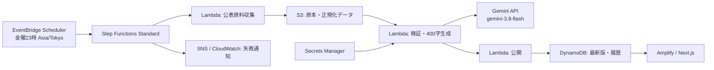

# 週次レポートの実装・運用

**Gemini対応：** LambdaからGemini APIを直接呼び出します。FIGURE01～05の統計・注記・プロンプトに変更があった場合のみ400字要約を生成します。[構築・更新手順](weekly-reports-aws-setup.md)を参照してください。AWSへの反映は別途必要です。

**初めてAWSを構築する方は、[AWS構築手順書（初心者向け）](weekly-reports-aws-setup.md)を上から順に進めてください。** 本ページは統計定義・実装の参照資料です。導入対象は `markets` モードのFIGURE01～05です。

`/weekly-reports` に「日本のマクロ金融環境」を表示します。ホーム・週次定点観測・サイト情報のナビゲーション、FIGURE01～05、出典、AI推論による400字以内の本文を実装しています。過去本文の表示欄はありますが、現在の `markets` モードから履歴一覧への保存は未実装です。

## FIGURE05：富の偏りと失業率（1995年以降）

FIGURE05は年次統計です。左軸は完全失業率（全国・男女計の年平均）と平均所得以下の世帯割合の％、右軸は全世帯の1世帯当たり平均所得金額の万円です。横軸は所得の対象年で、所得調査年の前年に配置します。平均所得は名目額であり、個人給与・可処分所得・資産残高ではありません。世帯割合は貧困率ではなく、所得分布を見る補助指標です。

失業率は指定e-Stat一覧の表2-1（年平均、`statInfId=000001082681`）の男女計・完全失業率列を使用。年度平均・男女別・完全失業者数を混ぜません。所得2系列は厚生労働省の各年の概況にある「所得の分布状況」の公表値を使用。2007年所得以前の本文の「平均額より低い」表記もメタデータに残しています。

初期データは失業率1995～2025年、所得1995～2024年（2019年を除く）。2020年調査中止による2019年所得は補間しません。所得2010年は岩手・宮城・福島、2011年は福島、2015年は熊本を除きます。失業率2011年は統計局公表の補完推計値です。

`workers/weekly-report/household.py` が週次処理で年平均Excelと最新所得概要を取得・検証し、原本は既存Fetcher経由でS3へ保存します。公表が年次のため毎週数値が変わるとは限りません。過去分は `data/household.json` の出典URL・取得日時・SHA-256付きデータを維持します。フロント側の同梱データは `lib/reports/data/household.json`。初回取得の再現は `scripts/research-household.py`、e-Stat Excelを `tmp/household/unemployment.xlsx` に保存したうえで `scripts/import-household-history.py` を実行します。Python依存ライブラリは既存週次Workerと同じです。

WEEKLY INSIGHTはFIGURE01～04の3論点を中心に、FIGURE05の所得・失業率も考察に含めます。左右固定軸は単位を個別指定でき、FIGURE05の右軸目盛りに％を付けません。

## AWS構成

既存の広告・決済スタックから独立した `infra/weekly-reports.yaml` を使用します。以下は処理の概念図です。実際には1つのLambda Workerを使用し、現在の `markets` モードではCollect内で収集・生成・保存を行います。



AWS側はすべてフルマネージドです。モデルはGemini APIの `gemini-3.8-flash` を直接呼び出します。Amazon Bedrockのモデルとしては扱いません。別モデルへの自動切替はありません。金曜23時は**更新確認開始時刻**であり、収集・検証・生成が終わった時点で公開します。

## データ定義と取得状況

数値は決定的なパーサーで取得し、AIに数値の生成・欠測補完をさせません。FIGURE01・02・04の対象期間は直近の終了済み100半期（50年、6月末・12月末）。FIGURE03は60半期（30年）を維持します。初期表示は50年で、30・10・5年にも切り替えられます。従来の全13系列モードは60半期のままです。日次データは該当月の最終観測値、月次・四半期残高は半期末、建設受注は6か月の合計です。6か月が揃わなければ合計を掲載しません。年度末の値を暦年末として表示することもありません。

| 項目 | 使用する公表系列・取得方法 | 留意点 |
| --- | --- | --- |
| 国債3・10・30年 | 財務省 `data/jgbcm_all.csv` と当月 `jgbcm.csv` | 30年金利は1999年9月以降。負の金利を保持 |
| フラット35（中間値） | 住宅金融支援機構の金利推移PDFと当月金利表 | （最高金利＋最低金利）÷2。2003年12月～2026年6月の46半期。実際の借入金利の平均ではない。2007年10月以降は21～35年、2010年4月以降は融資率9割以下、2017年10月以降は新機構団信付き |
| TOPIX | JPX「指数値の推移」の年間四本値Excel | `topixyear_j.xls` の「年（月）末」列。年末終値、ポイント。6月・未収録年は補間しない |
| 時価総額 | JPXの長期Excelを毎回リンク探索 | 東証内国株式の全市場合計。全国取引所合計ではない。2022年市場再編以前のシートも取得 |
| 建設受注 | e-Statの受注高時系列Excelをリンク探索 | 全国・全業者、元請と下請を含む総受注高。大手50社や前年比表とは区別。古い月は初期CSVで補う |
| 企業向け貸出 | 日銀 FF `FOF_FFALA00A411` | 預金取扱機関 → 民間非金融法人 |
| 個人向け貸出 | 日銀 FF `FOF_FFALA00A430` | 預金取扱機関 → 家計（個人事業主を含む） |
| 公共団体向け貸出 | 日銀 FF `FOF_FFALA00A422` | 預金取扱機関 → 地方公共団体。中央政府や公的企業の合計ではない |
| 国債保有 | 日銀 FF `FOF_FFAS120A311` | 預金取扱機関の国債・財投債。ユーザー確認に基づき貸出とは区別 |
| 日銀総資産・国債 | 日銀 BS01 `MABJMTA`・`MABJMA5` | 現行系列は1998年4月以降。国債は総資産の内数・短期国債を含む |

日銀の金額は億円から兆円へ、JPX・建設受注は百万円から兆円へ変換します。資金循環の上記四半期系列は1997年末以降です。これらの公表系列だけで30年すべてが埋まるとは限りません。異なる制度・対象範囲の旧系列を自動で接続しません。

経産省、全銀協、日本証券業協会、日本プライベート・エクイティ協会、住宅金融支援機構、日本経済研究センターの公表ページと取得可能な関連資料を文章生成の補助資料として収集します。索引タイトルから資料本文を推測しないよう指示しています。対象機関・財団を追加する場合は `sources.py` の `CONTEXT_SOURCES` と `ALLOWED_HOSTS` に明示的に登録します。取得できなかった参考資料は警告に表示し、出典を創作しません。

## 初期データを準備する

### FIGURE02：金利と国内銀行の貸出残高

ユーザー提供の `nme_R031.3231299.20261012152254.02.csv` を使用。出所は[日本銀行時系列統計データ検索サイト・貸出先別貸出金（LA01）](https://www.stat-search.boj.or.jp/ssi/cgi-bin/famecgi2?cgi=$nme_a000&lstSelection=LA01)です。対象は国内銀行の銀行勘定・信託勘定・海外店勘定の合計で、総貸出残高 `DLLILKG90_DLLI5DS2T` と個人向け住宅資金残高 `DLHLLKG71_DLHL2DSSL` の2系列。日銀APIの同一コードで単位「億円」を確認し、10,000で割って兆円に換算しています。「住宅資金」「法人向け（金融業含む）」「それ以外（総貸出－住宅資金－法人向け）」を積み上げ、合計を総貸出残高に一致させます。法人向けは日銀LA01の `DLLILKG84_DLLI5DS2THKL`（国内銀行3勘定合算の法人計〈含金融〉）を使用し、個人企業も含みます。それ以外には住宅資金以外の個人向け、地方公共団体、海外円借款等が残ります。1976年以降の総貸出・住宅資金と1993年6月以降の法人向けを収めた原本API応答は `workers/weekly-report/data/lending-history-la01.json`。取得URL・日時・SHA-256は貸出スナップショットに保存。1995年3月以降の総貸出・住宅資金は提供CSVを優先します。法人向けが未取得の1993年6月より前は総貸出－住宅資金を「住宅資金以外（法人内訳未取得）」として灰色表示し、法人向けをゼロと推定しません。法人向けの棒と凡例は薄青色 `#93c5fd`。差分は億円単位に戻して計算し、兆円の小数第4位まで保持します。

提供CSVと同一定義の過去APIデータから、FIGURE01と同じ1976年12月～2026年6月の100半期末を表示します。空欄の2026年9月・12月は観測値にしません。金利3系列はFIGURE01の値をそのまま共有し、同じ色・右軸%で表示。左軸は貸出残高の兆円、横軸ラベルは毎年12月です。総貸出・住宅資金は提供CSV、法人向けは取得済みAPI応答のスナップショットを使用し、自動で最新データへ差し替わる設計ではありません。CSV再取り込み時にも法人向け原本を再結合し、内訳が総額を超えた場合は停止します。

### FIGURE03：金利と日本銀行の資産

[日本銀行の会計・決算](https://www.boj.or.jp/about/account/index.htm)からリンクされた財務諸表の「資産の部合計」と「国債」を取得。国債（短期・長期を含む）と差額のその他資産を兆円に換算し積み上げます。勘定科目「その他資産」をそのまま使うものではありません。2026年10月12日の取得範囲は2019年9月末～2026年3月末の14決算期。ユーザー指定により関連統計では補完せず、30年軸の未取得期間は空欄です。

残高は実際の3月末・9月末に置き、金利の6月末・12月末へ移しません。四半期刻みの座標で配置し、横軸のラベルは毎年12月のみ。金利線は観測点間を結びますが、中間四半期の金利値は作りません。図表・要約は完了済み半期までを対象とします。

週次収集は財務諸表のリンクを再探索し、原本をS3へ保存。比較欄の前年値も取得し、重複は新しい公表資料を優先します。前回保存分と同梱データを保持するため、古いリンクが一覧から外れても履歴は残ります。表構造・単位・数値が不正なら公開を停止します。手動再取得は `python scripts/refresh-boj-financials.py`。取得値変更時は本文を削除して再生成待ちにします。

### FIGURE04：政府の債務残高と利払い負担

[財務省の国債及び借入金現在高](https://www.mof.go.jp/jgbs/reference/gbb/data.htm)から1996年12月末～2026年6月末の60半期を収録。最近5年間のExcelと、同ページが案内する国立国会図書館WARP保存ページを使用しています。内国債・借入金・政府短期証券の合計を億円から兆円に換算し、政府保証債務は除きます。国の内部保有等を含み、一般政府の連結債務・純債務とは異なります。

政府債務の表示軸も50年ですが、1996年12月より前は同一定義・同一観測日の未取得値を空欄にしています。普通国債だけの年度末残高で代用しません。

1977～1996年度の利払費・一般会計当初予算総額は財務省「財政金融統計月報第744号」第3表の億円単位の値を使用。国立国会図書館保存Excelを `workers/weekly-report/data/budget-744-03.xls` に保存し、SHA-256とURLを正規化データに記録しています。取り込みコマンドは `python scripts/extend-observation-history.py --budget-xls workers/weekly-report/data/budget-744-03.xls`。1977～2026年度の50年分の当初予算で比較します。

同じFIGURE04内の別グラフに、[年度別予算資料](https://www.mof.go.jp/policy/budget/budger_workflow/budget/index.html)の1997～2026年度一般会計当初予算の利払費を棒、歳出総額に占める割合を線で表示します。利払費は予算書の「国債（公債）利子等支払財源の国債整理基金特別会計へ繰入れに必要な経費」と年金特例公債分の合計。元本償還費・事務取扱費は含みません。2000年度は省庁再編前後の大蔵省・財務省分を合算。分母は財政統計第19表（2）`19b.xlsx` の各年度「当初予算」列の一般会計歳出合計です。補正予算・決算と混ぜず、千円を兆円へ換算します。2026年度は利払費13.037146231兆円、歳出122.309247035兆円、比率10.6591664547％です。

初期値・資料URL・該当PDFページ・原本SHA-256は `workers/weekly-report/data/fiscal.json` に保存。週次処理では最新残高Excelと予算総額を再取得し、新年度分は公式予算書PDFを解析します。保存済みの過年度利払費は維持します。未公表期間は補間しません。手動更新は `python scripts/refresh-fiscal.py`（現在の図表期間を維持し本文を無効化）。図表全体の期間更新は `scripts/refresh-market-chart.py` を使用します。

要約は5図の表示用データを統合して400字以内で生成します。金利増減と貸出残高増減、政府の国債等残高増減と利払費増減、日銀の国債保有増減と民間金融機関への影響予測の3点を中心にFIGURE05の所得・失業率も簡潔に扱います。民間債務全体と銀行貸出の集計範囲を区別し、民間金融機関の国債購入については予測として記述します。日銀保有減少や政府残高との差額を民間金融機関の保有増加とみなさず、海外投資家等の可能性と、実際の保有増減・政策の因果的効果は分からないことを明記する指示です。同梱の初回文はAI作成339字で、Gemini APIによる定期生成結果ではありません。

元CSVは `workers/weekly-report/data/lending-la01.csv`、抽出結果・出典・SHA-256は `lib/reports/data/lending.json` に保存しています。貸出データはこの添付の固定スナップショットです。差し替えは `python scripts/import-lending.py <CSVのパス>` を実行し、アプリを再公開します。金利は既存の週次更新結果を共有します。

先行図表のフラット35・TOPIXには確認済みの履歴を同梱しており、初回用CSVの追加は不要です。以下は他系列を含む履歴補充の仕様です。建設受注はe-Statから取得・検証した2005年4月～2026年7月の256か月分を `workers/weekly-report/data/construction.csv` に同梱しています。1996年～2005年前半は未収録です。ダミーの数値は同梱していません。

UTF-8 CSVの必須列は次のとおりです。

```csv
date,value,unit,source_name,source_url
```

- `date`: `YYYY-MM-DD`。株価は月末最終営業日、金利は観測日または適用日、建設受注は月末。未公表・将来の日付は使用しない。
- `value`: 実測数値。欠測をゼロにしない。
- `unit`: フラット35は `%`、TOPIXは `ポイント`、建設受注は `兆円`。
- `source_name`, `source_url`: 各行の資料名と公式HTTPS URL。出典はホスト許可リストで検証する。
- フラット35の開始前の値や異なる返済期間・融資率の金利を混ぜない。CSVの数値・定義・利用条件は投入前に確認する。
- 認可済みの別のデータ提供会社を使用する場合は、そのURL・形式・認証方法に合わせたアダプターを追加する。任意URLの無制限取得はしない。

建設受注の公表ファイルを遡って出典付きCSVを作成するコマンドも用意しています。

```sh
python -m pip install -r workers/weekly-report/requirements.txt
python scripts/backfill-construction.py --as-of 2026-10-11 --output construction.csv
```

その時点のe-Stat分類に存在する公表値のみを収録し、取得できない年・半期をログに表示します。出力と欠測一覧を確認してから、必要に応じて `imports/construction.csv` に置いて同梱履歴を更新できます。初期の統計は分類・対象範囲が変わっているため、このコマンドだけで1996年までの同一定義の系列が得られる保証はありません。

S3配置先は `imports/<seriesId>.csv` です。既存の全13系列に対応しているので、確認済みの旧公表値も同じ方式で追加できます。毎週、前回までの観測履歴→CSV→最新公表値の順で統合します。最新公表値が重なる月は最新公表値を優先します。原本と実行時の入力CSVもS3に保存します。

現在の先行図表ではTOPIXはJPXの年間四本値Excel、フラット35は住宅金融支援機構の最高・最低金利の中間値を使用します。フラット35の履歴は公式PDFに印字された数値を確認して `data/flat35-range.csv` に収録（最低・最高・出典URL・確認日時を保存）。当月の公式HTMLを毎週読み取り、同じ式で計算します。以前の銀行別・最低金利の履歴は統合しません。

### アップロード前のCSV検証

次のコマンドで、ネットワーク接続やAWSへの書き込みを行わずに、列・単位・出典URL・重複日・未来日・鮮度を検証できます。半期データが一つもない場合もエラーになります。

```sh
python scripts/check-report-import.py topix topix.csv
python scripts/check-report-import.py flat35 flat35.csv
```

成功時には観測数・最新日・利用可能な半期数・欠測半期を表示します。欠測は補完しません。終了コード0は入力形式と基本条件の合格を意味し、30年分の完全性や資料の利用許諾を保証するものではありません。

## 最初の図表の先行実装

FIGURE01の表示対象は国債10年・30年・フラット35（中間値）の折れ線と、TOPIXの棒グラフです。国債3年は表示・要約入力から除外しています。自動生成する本文はFIGURE01～05を統合します。同梱の初回本文は旧版です。同梱文は実装時にAIが作成した文章で、Gemini 3.8 Flash APIの定期実行結果ではありません。観測値は半年ごと、横軸ラベルは各年12月のみ。単位はグラフ上部に独立して表示し、狭い画面では横スクロールできます。

`markets` モードでも `GeminiSecretArn` を設定すると、FIGURE01の4系列、FIGURE02の貸出残高、FIGURE03の財務諸表、FIGURE04の政府債務・利払費、FIGURE05の所得・失業率、各観測日・出典をGemini 3.8 Flashに渡し、400字以内のまとめを図表と同じスナップショットに保存します。取得日時を除くデータ・プロンプト・モデルのハッシュが前回と同じならAPIを呼ばず、前回本文と生成日時を引き継ぎます。参考記事・国債3年・図表にない直近値は渡しません。生成に失敗した場合は公開せず、前回の図表と本文を保持します。キー未設定の場合は図表のみ更新し、古い本文を新しい図表に流用しません。ローカル更新コマンドも本文を生成しないため、再取得後は本文の再作成が必要です。Gemini生成のスナップショットは `summaryScope: five-figures-v1` です。既存の `four-figures-v6` の表示互換性は維持しますが、初回のGemini実行では5図の本文を新規生成します。

FIGURE01は「金利とTOPIX」です。TOPIXはユーザー提供の `topixyear_j.xls`（1949～2025年、77年分）を読み取り、1976～2025年の50年末を表示します。参照情報は[JPX「TOPIX」ページの「指数値の推移」](https://www.jpx.co.jp/markets/indices/topix/)と、その年間四本値Excelです。「年（月）末」列だけを使い、年初・高値・安値を混同しません。6月や2026年の値はこの資料にないため欠測です。元ファイルは `workers/weekly-report/data/topixyear_j.xls`、抽出結果・SHA-256は `data/topix.json` に保存しています。再取り込みは `python scripts/import-topix-annual.py <Excelのパス>`。値を変更すると旧まとめは削除されるため、図表に合わせて再作成します。

フラット35は機構公表の2003年12月～2026年6月の46半期を収録し、最新の観測月は2026年10月です。PDFの数値は文字抽出では拾えないアウトライン文字だったため、画像として確認して転記しました。線の座標からの推計はしていません。中間値はDecimalで計算し、小数第4位まで保持します。制度変更による条件の違いを注記し、公表開始前は補間しません。銀行別金利の保存済み図表は定義識別子 `range-midpoint-v1` がないため表示せず、新定義の同梱図表を表示します。

```sh
python scripts/refresh-market-chart.py
```

このコマンドはJPXの年間四本値Excelを読み、財務省の国債金利、機構のフラット35履歴CSVと当月金利を合わせて図表JSONを更新します。Python依存ライブラリのインストールが必要です。AWSや生成AIは呼び出しません。

SAMの `ReportScope` は既定で `markets` です。このモードでは4図のデータと任意の生成本文を `CHART / MARKETS` に保存します。財務諸表・財政資料の取得は必須、本文生成とGeminiキーは任意です。市場モードの本文は最新版とS3の実行記録に保存され、全体モードのHISTORY一覧への保存はまだ行いません。公開済みの全体レポートがない場合、Web側はこの図表を表示します。テーブル未設定または図表未登録の場合は同梱の実測値を、収集基準日付きで表示します。AWS通信障害時は静的データへ黙って切り替えません。

TOPIXは毎週、同じ公式Excelを取得し、年末終値を置き換えます。以前の月報・CSVの値とは統合しません。年次資料なので鮮度判定は400日（年次更新と公表猶予）です。保存済み図表も `annual-close-v1` の定義識別子を確認し、旧月次データは表示しません。取得・検証に失敗した場合は直前の図表を保持します。フラット35は当月金利を毎週取得し、同じ定義の保存済み観測値を引き継ぎます。履歴PDFの改定はCSVの再確認が必要です。

最初の図表だけを導入する際は、下記のGeminiキー準備と必須CSV配置を省略できます。全体レポートを有効にする場合のみ `ReportScope=full` とし、残りのデータ・キーを準備してください。AWSへのデプロイと定期実行の有効化は未実施です。

## AWSへの導入

実際の操作は [AWS構築手順書](weekly-reports-aws-setup.md) に集約しています。APIキーの保存、SAMによる一括構築、手動実行、Amplify接続、毎週実行の有効化の順で進めます。

現在の5図表には `ReportScope=markets` を指定します。初回CSVのS3アップロードは不要です。Weekly Insightを生成するためにGeminiSecretArnを設定し、手動実行が成功するまではScheduleState=DISABLEDを維持します。対象範囲はコードと新しい手順書を参照してください。

## 公開時の検証・障害対応

- 必須13系列の欠落、全半期が欠測、異常単位、未来日付、古すぎる最新観測、本文401文字以上、不明な出典ID、APIエラーは公開を停止する。
- 鮮度上限は四半期資金循環220日、それ以外120日。必ず最新観測日も画面に表示する。原資料の公表ラグと観測日を区別する。
- 一部参考文章の取得失敗は警告として残す。公開統計の欠落をAIの推測で埋めない。
- DynamoDBトランザクションで最新本文と履歴を同時に確定。日付キーで重複公開を防ぎ、遅れて終了した古い実行は最新を上書きしない。
- S3は公開禁止・暗号化・バージョニング。DynamoDBはオンデマンド・PITR。両方ともスタック削除時に保持する。
- Step Functions再試行、SNS失敗通知、CloudWatch失敗・タイムアウト通知、Scheduler配信失敗のSQS DLQを用意。前回公開分は失敗時にも残り、8日以上更新されなければ画面に遅延表示。
- `runs/<予定日>/<実行ID>/` の `collected.json`、原本、`generation-audit.json`、`report.json` で追跡可能。ログにAPIキーやAPI応答全文を出さない。
- 400字と出典IDの機械検証は、文章の経済解釈の正しさを保証するものではない。初回は出典・統計の定義・推論を確認する。

## 検証コマンド

```sh
npm test
npx tsc --noEmit
npm run build
python -m unittest discover -s workers/weekly-report -p "test_*.py"
sam validate --lint --template-file infra/weekly-reports.yaml
python scripts/check-report-sources.py
```

PythonのローカルテストではAWS SDK `boto3` も必要です（Lambdaランタイムには同梱）。ライブ統計検証はAWSへの書き込み・Gemini呼び出しを行いません。モデルAPIとAWS上の実行の疎通確認は、秘密情報とデプロイ先が設定されてから行います。

## 公式仕様

- [Gemini API料金・無料枠](https://ai.google.dev/gemini-api/docs/pricing)
- [Gemini構造化出力](https://ai.google.dev/gemini-api/docs/structured-output)
- [EventBridge Schedulerのスケジュールとタイムゾーン](https://docs.aws.amazon.com/scheduler/latest/UserGuide/schedule-types.html)
- [日銀・統計APIマニュアル](https://www.stat-search.boj.or.jp/info/api_manual.pdf)
- [財務省・国債金利](https://www.mof.go.jp/jgbs/reference/interest_rate/index.htm)
- [JPX・市場別時価総額](https://www.jpx.co.jp/markets/statistics-equities/misc/02.html)
- [住宅金融支援機構・フラット35の金利推移](https://www.flat35.com/kinri/kinri_suii.html)

図表の左右の縦軸・単位・凡例は横スクロール領域の外に配置しています。固定軸とプロットは共通の目盛り・範囲を使い、積み上げ棒は合計値、金利は負の値を含めて範囲を決めます。

Weekly Insightは過去50年を主軸とし、金利・貸出と政府債務・利払費について初期・中間・直近の変化を比較します。日銀は取得済みの2019年以降のみを扱い、長期実測の観察と条件付き将来予測を区別します。30年先の予測や欠測の補完は行いません。

## FIGURE06：金利とインフレ率（コア指標）

`app/weekly-reports/inflation-chart.tsx` に年次推移を表示します。日銀の[分析データ](https://www.boj.or.jp/research/research_data/index.htm)の[消費者物価のコア指標Excel](https://www.boj.or.jp/research/research_data/cpi/cpirev.xlsx)を `scripts/import-core-inflation.py` で読み、`lib/reports/data/core-inflation.json` に保存します。

初回収録は1986～2025年の40暦年。指定Excelの最長系列（加重中央値・最頻値）は1986年開始のため50年には届きません。刈込平均値は2001年、生鮮食品・特殊要因を除く指標は2016年開始です。公表開始前は欠測。前年比の月次値12個、加重中央値・最頻値は四半期値4個を単純平均し、全期間がそろった完成暦年のみ表示します。年平均物価指数の前年比とは区別します。Excelで分かれた各基準年の適用期間を接続し、重複列を検出したら停止します。

金利はFIGURE02・03と同じ系列の国債10年の12月観測値を使用。半期の平均や金利の年平均には変換しません。未収録の金利を補間しません。共通の％軸、金利は破線、インフレ率は実線。表示期間セレクターと右端の初期表示を共用します。AI本文・AWS収集処理の入力には追加していません。

更新・検証：`python scripts/import-core-inflation.py`、`python scripts/test_core_inflation.py`、`npm.cmd test -- lib/reports/core-inflation.test.ts`。取得・検証の成功後にJSONを置換します。

2026年10月20日、同梱のマクロ要約を375字に更新しました。FIGURE06の2025年刈込平均インフレ率とFIGURE05の所得・失業率を含む、掲載図表のデータに基づくAI作成文です。`markets.json` の `insight.model` は `initial` を維持し、Gemini APIによる定期実行結果とは区別しています。既存のAWS定期生成・過去要約履歴の保存処理はこの文章更新では変更していません。

## 2026年10月25日：株価評価指標と図の順序

FIGURE01を「株価評価指標」に変更し、金利を外しました。TOPIXの年末終値を維持し、JPX「規模別・業種別PER・PBR」の長期データ（総合）から、連結・単純平均のPERとPBRを月次で追加しています。上記の旧FIGURE01に関する金利の記述は、この変更前の構成です。FIGURE02は「日本銀行の金融政策」（旧FIGURE03）、FIGURE03は「金利と国内銀行の貸出残高」（旧FIGURE02）です。

PER・PBRは1999年1月～2026年9月を初回収録。現行市場（プライム・スタンダード・グロース）を初期表示し、旧市場（第一部・第二部・マザーズ・JASDAQ）へ切り替えられます。2022年4月の再編前後を接続せず、PER・PBR・TOPIXは単位・水準に応じて独立した3段の図としています。旧市場の一部で公表がない期間、「－」「＊」は欠測のまま保持。連結を作成しない会社はJPXの定義どおり単体を含みます。加重平均・予想PER・単体系列との混在はありません。

更新：`python scripts/import-equity-valuations.py`。JPXのページから長期Excelリンクを解決し、シート見出し・列・数値を検証後に `lib/reports/data/equity-valuations.json` を置換します。出典URL・取得日時・原資料SHA-256も保持します。Excel自体は編集しません。検証：`npm.cmd test -- lib/reports/equity-valuations.test.ts`。最新月は別掲載の月次Excelとも照合しました。今回の追加はサイト同梱データであり、AWSの週次収集・要約入力へのPER・PBR追加は含みません。
