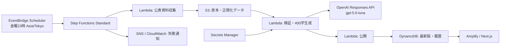

# 週次レポートの実装・運用

`/weekly-reports` に「日本のマクロ金融環境」を表示します。ホーム・週次レポート・サイト情報のナビゲーション、5図表、出典、AIの推論であることを明記した400字以内の本文、作成日時付きの過去本文を実装しています。

## AWS構成

既存の広告・決済スタックから独立した `infra/weekly-reports.yaml` を使用します。



AWS側はすべてフルマネージドです。モデルはOpenAI APIの `gpt-5.6-luna` を直接呼び出します。Amazon Bedrockのモデルとしては扱いません。別モデルへの自動切替はありません。金曜23時は**生成開始時刻**であり、収集・検証・生成が終わった時点で公開します。

## データ定義と取得状況

数値は決定的なパーサーで取得し、AIに数値の生成・欠測補完をさせません。対象期間は直近の終了済み60半期（6月末・12月末）。日次データは該当月の最終観測値、月次・四半期残高は半期末、建設受注は6か月の合計です。6か月が揃わなければ合計を掲載しません。年度末の値を暦年末として表示することもありません。

| 項目 | 使用する公表系列・取得方法 | 留意点 |
| --- | --- | --- |
| 国債3・10・30年 | 財務省 `data/jgbcm_all.csv` と当月 `jgbcm.csv` | 30年金利は1999年9月以降。負の金利を保持 |
| フラット35 | 公式の当月金利表を自動取得。過去分は出典付きCSV | 21～35年・融資率9割以下の最低金利。2017年10月以降は新機構団信付き。2003年10月以前は掲載しない。公表PDFの線を数値と見なして自動変換しない |
| TOPIX | 出典付きCSVの取り込み | 半期末の配当なし指数の終値、ポイント。出典付きの実測値を使用 |
| 時価総額 | JPXの長期Excelを毎回リンク探索 | 東証内国株式の全市場合計。全国取引所合計ではない。2022年市場再編以前のシートも取得 |
| 建設受注 | e-Statの受注高時系列Excelをリンク探索 | 全国・全業者、元請と下請を含む総受注高。大手50社や前年比表とは区別。古い月は初期CSVで補う |
| 企業向け貸出 | 日銀 FF `FOF_FFALA00A411` | 預金取扱機関 → 民間非金融法人 |
| 個人向け貸出 | 日銀 FF `FOF_FFALA00A430` | 預金取扱機関 → 家計（個人事業主を含む） |
| 公共団体向け貸出 | 日銀 FF `FOF_FFALA00A422` | 預金取扱機関 → 地方公共団体。中央政府や公的企業の合計ではない |
| 国債保有 | 日銀 FF `FOF_FFAS120A311` | 預金取扱機関の国債・財投債。ユーザー確認に基づき貸出とは区別 |
| 日銀総資産・国債 | 日銀 BS01 `MABJMTA`・`MABJMA5` | 現行系列は1998年4月以降。国債は総資産の内数・短期国債を含む |

日銀の金額は億円から兆円へ、JPX・建設受注は百万円から兆円へ変換します。資金循環の上記四半期系列は1997年末以降です。これらの公表系列だけで30年すべてが埋まるとは限りません。異なる制度・対象範囲の旧系列を自動で接続しません。

経産省、全銀協、日本証券業協会、日本プライベート・エクイティ協会、住宅金融支援機構、日本経済研究センターの公表ページと取得可能な関連資料を文章生成の補助資料として収集します。索引タイトルから資料本文を推測しないよう指示しています。対象機関・財団を追加する場合は `sources.py` の `CONTEXT_SOURCES` と `ALLOWED_HOSTS` に明示的に登録します。取得できなかった参考資料は警告に表示し、出典を創作しません。

## 初期データを準備する

**初回公開には `flat35.csv` と `topix.csv` が必要です。** 建設受注はe-Statから取得・検証した2005年4月～2026年7月の256か月分を `workers/weekly-report/data/construction.csv` に同梱しています。1996年～2005年前半は未収録です。ダミーの数値・AI本文は同梱していません。

UTF-8 CSVの必須列は次のとおりです。

```csv
date,value,unit,source_name,source_url
```

- `date`: `YYYY-MM-DD`。株価は月末最終営業日、金利は観測日または適用日、建設受注は月末。未公表・将来の日付は使用しない。
- `value`: 実測数値。欠測をゼロにしない。
- `unit`: フラット35は `%`、TOPIXは `ポイント`、建設受注は `兆円`。
- `source_name`, `source_url`: 各行の資料名と公式HTTPS URL。出典はホスト許可リストで検証する。
- フラット35の開始前の値や異なる返済期間・融資率の金利を混ぜない。CSVの数値・定義・利用条件は投入前に確認する。
- 認可済みの別のデータ提供会社を使用する場合は、そのURL・形式・認証方法に合わせたアダプターを追加する。任意URLの無制限取得はしない。

建設受注の公表ファイルを遡って出典付きCSVを作成するコマンドも用意しています。

```sh
python -m pip install -r workers/weekly-report/requirements.txt
python scripts/backfill-construction.py --as-of 2026-10-11 --output construction.csv
```

その時点のe-Stat分類に存在する公表値のみを収録し、取得できない年・半期をログに表示します。出力と欠測一覧を確認してから、必要に応じて `imports/construction.csv` に置いて同梱履歴を更新できます。初期の統計は分類・対象範囲が変わっているため、このコマンドだけで1996年までの同一定義の系列が得られる保証はありません。

S3配置先は `imports/<seriesId>.csv` です。既存の全13系列に対応しているので、確認済みの旧公表値も同じ方式で追加できます。毎週、前回までの観測履歴→CSV→最新公表値の順で統合します。最新公表値が重なる月は最新公表値を優先します。原本と実行時の入力CSVもS3に保存します。

TOPIXは、提供元の更新に合わせてS3上のCSVも更新する運用が必要です。フラット35は過去分のCSVが必要ですが、運用開始後の当月分は公式金利表から自動取得し、次の実行へ引き継ぎます。CSVのアップロード自体を毎週自動収集したことにはしません。TOPIXの取得先が決まればそのアダプターを追加できます。

### アップロード前のCSV検証

次のコマンドで、ネットワーク接続やAWSへの書き込みを行わずに、列・単位・出典URL・重複日・未来日・鮮度を検証できます。半期データが一つもない場合もエラーになります。

```sh
python scripts/check-report-import.py topix topix.csv
python scripts/check-report-import.py flat35 flat35.csv
```

成功時には観測数・最新日・利用可能な半期数・欠測半期を表示します。欠測は補完しません。終了コード0は入力形式と基本条件の合格を意味し、30年分の完全性や資料の利用許諾を保証するものではありません。

## 最初の図表の先行実装

表示対象は国債10年・30年・フラット35の折れ線と、TOPIXの棒グラフです。国債3年は表示・この図表の要約入力から除外しています。初回の236字のまとめを同梱し、「初回掲載文（AI作成）」と明示しています。これはこの実装作業で図表の数値から作成した文章で、GPT-5.6-luna APIの実行結果ではありません。

`markets` モードでも `OpenAISecretArn` を設定すると、表示対象の4系列・半期・出典・欠測情報だけをGPT-5.6-lunaに渡して400字以内のまとめを生成し、図表と一緒に保存します。他の図表・参考記事・国債3年・図表にない直近値は渡しません。生成に失敗した場合は公開せず、前回の図表と本文を保持します。キー未設定の場合は図表のみ更新し、古い本文を新しい図表に流用しません。ローカル更新コマンドも本文を生成しないため、再取得後は本文の再作成が必要です。

現在は「金利とTOPIX」を先行表示します。`lib/reports/data/markets.json` は2026年10月12日に公式サイトから取得した実測値です。国債3年・10年は60半期、30年は54半期、TOPIXは22半期（2015年12月末～2026年6月末）を収録しています。TOPIXの最新観測は2026年8月末です。月報の第3-1表の先頭数値列（配当なしTOPIX）を使用し、配当込み指数・年次値・日次値は取り込みません。

フラット35は2026年10月の金利のみ取得済みで、過去の半期末値は欠測です。図表は30年の期間を確保しますが、未取得の期間を補間して30年分揃ったようには表示しません。各系列の収録範囲・出典・取得日時を画面に表示します。

```sh
python scripts/refresh-market-chart.py
```

このコマンドはJPXの現行月報とバックナンバー一覧から各年の最新月報を読み、財務省の国債金利、住宅金融支援機構の当月金利と合わせて図表JSONを更新します。Python依存ライブラリのインストールが必要です。AWSや生成AIは呼び出しません。

SAMの `ReportScope` は既定で `markets` です。このモードでは毎週の収集後に `CHART / MARKETS` をDynamoDBへ保存して処理を終了し、他の統計・400字本文・OpenAIキーを必要としません。公開済みの全体レポートがない場合、Web側はこの図表を表示します。テーブル未設定または図表未登録の場合は同梱の実測値を、収集基準日付きで表示します。AWS通信障害時は静的データへ黙って切り替えません。

過去のTOPIXはLambdaに同梱した `data/topix.json` と前回収集データから引き継ぎ、毎週の最新月報で改定値を優先します。取得・検証に失敗した場合は直前の図表を保持します。フラット35の検証済み履歴CSVをS3に配置すれば、その履歴も統合します。

最初の図表だけを導入する際は、下記のOpenAIキー準備と必須CSV配置を省略できます。全体レポートを有効にする場合のみ `ReportScope=full` とし、残りのデータ・キーを準備してください。AWSへのデプロイと定期実行の有効化は未実施です。

## AWSへの導入

1. 東京リージョンのSecrets Managerで、JSON `{"apiKey":"実際のAPIキー"}` を格納したシークレットを準備します。キーをNext.jsやクライアント環境変数に設定しないでください。独自KMSキーで暗号化する場合はWorkerロールに該当キーの `kms:Decrypt` 権限も必要です。
2. Python 3.13、AWS SAM CLI、AWS認証情報を用意し、独立スタックとしてビルド・デプロイします。

```sh
sam build --template-file infra/weekly-reports.yaml --build-dir .aws-sam/weekly-build
sam deploy --guided --template-file .aws-sam/weekly-build/template.yaml
```

`OpenAISecretArn` を指定します。`ScheduleState` の初期値は `DISABLED`。`AlertEmail` を指定した場合はSNS購読確認メールで購読を有効にします。

3. 出力された `DataBucket` にCSVを配置します。

```sh
aws s3 cp flat35.csv s3://BUCKET/imports/flat35.csv
aws s3 cp topix.csv s3://BUCKET/imports/topix.csv
```

同梱分より長い・新しい建設受注履歴を用意した場合は、同様に `imports/construction.csv` へ配置してください。

4. Amplifyの環境変数 `WEEKLY_REPORTS_TABLE_NAME` に `ReportsTableName`、`APP_AWS_REGION` に `ap-northeast-1` を設定します。既存のビルド手順で `npm run build` の前に `npm run configure:reports` を実行してください。このコマンドはSSR用 `.env.production` にこの2変数のみを追記し、既存の他変数は保持します。ローカル開発では `.env.local` に設定します。
5. Amplify **SSR Compute Role** に以下を追加します。ビルド用ロールとは別です。秘密鍵、S3、生成処理の書き込み権限をWeb側に与える必要はありません。

```json
{
  "Effect": "Allow",
  "Action": ["dynamodb:GetItem", "dynamodb:Query"],
  "Resource": "ReportsTableArnの出力値"
}
```

6. Step Functionsを手動実行します。Input例の時刻は**実際の開始時刻**に置き換えます。過去の日付を指定して現在の資料から過去レポートを装う運用はしないでください。

```json
{"scheduledTime":"2026-10-16T14:00:00Z"}
```

7. 収集・生成・公開が成功し、`/weekly-reports` の図表・本文・出典を確認したら、同じスタックを `ScheduleState=ENABLED` で更新します。設定は `cron(0 23 ? * FRI *)`、`Asia/Tokyo`、柔軟な実行時間枠OFFです。初回デプロイ・Secrets Managerへのキー設定・スケジュール有効化はこの実装作業では行っていません。

## 公開時の検証・障害対応

- 必須13系列の欠落、全半期が欠測、異常単位、未来日付、古すぎる最新観測、本文401文字以上、不明な出典ID、APIエラーは公開を停止する。
- 鮮度上限は四半期資金循環220日、それ以外120日。必ず最新観測日も画面に表示する。原資料の公表ラグと観測日を区別する。
- 一部参考文章の取得失敗は警告として残す。公開統計の欠落をAIの推測で埋めない。
- DynamoDBトランザクションで最新本文と履歴を同時に確定。日付キーで重複公開を防ぎ、遅れて終了した古い実行は最新を上書きしない。
- S3は公開禁止・暗号化・バージョニング。DynamoDBはオンデマンド・PITR。両方ともスタック削除時に保持する。
- Step Functions再試行、SNS失敗通知、CloudWatch失敗・タイムアウト通知、Scheduler配信失敗のSQS DLQを用意。前回公開分は失敗時にも残り、8日以上更新されなければ画面に遅延表示。
- `runs/<予定日>/<実行ID>/` の `collected.json`、原本、`generation-audit.json`、`report.json` で追跡可能。ログにAPIキーやAPI応答全文を出さない。
- 400字と出典IDの機械検証は、文章の経済解釈の正しさを保証するものではない。初回は出典・統計の定義・推論を確認する。

## 検証コマンド

```sh
npm test
npx tsc --noEmit
npm run build
python -m unittest discover -s workers/weekly-report -p "test_*.py"
sam validate --lint --template-file infra/weekly-reports.yaml
python scripts/check-report-sources.py
```

PythonのローカルテストではAWS SDK `boto3` も必要です（Lambdaランタイムには同梱）。ライブ統計検証はAWSへの書き込み・OpenAI呼び出しを行いません。モデルAPIとAWS上の実行の疎通確認は、秘密情報とデプロイ先が設定されてから行います。

## 公式仕様

- [OpenAI GPT-5.6 Luna](https://developers.openai.com/api/docs/models/gpt-5.6-luna)
- [OpenAI Structured Outputs](https://developers.openai.com/api/docs/guides/structured-outputs)
- [EventBridge Schedulerのスケジュールとタイムゾーン](https://docs.aws.amazon.com/scheduler/latest/UserGuide/schedule-types.html)
- [日銀・統計APIマニュアル](https://www.stat-search.boj.or.jp/info/api_manual.pdf)
- [財務省・国債金利](https://www.mof.go.jp/jgbs/reference/interest_rate/index.htm)
- [JPX・市場別時価総額](https://www.jpx.co.jp/markets/statistics-equities/misc/02.html)
- [住宅金融支援機構・フラット35の金利推移](https://www.flat35.com/kinri/kinri_suii.html)
